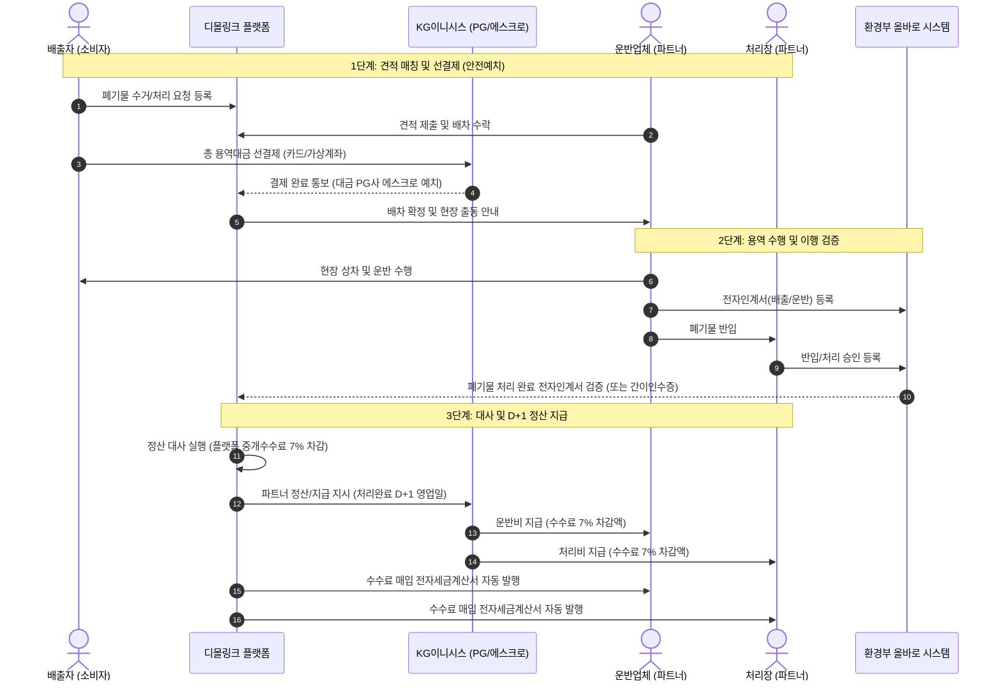

# [디몰링크] PG사(KG이니시스) 심사 보강 소명서 및 결제·정산 기획서

---

## 1. PG사 문의에 대한 공식 회신문 (이메일 제출용)

> **수신**: KG이니시스 가맹점 심사 담당자 귀하  
> **발신**: 디몰링크 운영팀  
> **제목**: [디몰링크] 가맹점 재심사 요청에 따른 추가 소명 자료 및 보증금 수취 방식 회신의 건  

안녕하세요, 건설폐기물 수거·운반·처리 매칭 플랫폼 **디몰링크**입니다.

요청해 주신 서비스 이용약관, 정산 흐름도, 에스크로 프로세스 기획서와 입점업체 플랫폼 보증금 수취 방식에 대해 아래와 같이 소명 자료를 제출하오니 재검토 부탁드립니다.

### [핵심 질의 회신] 입점업체 보증금 수취 방식
* **질의 내용**: 업체 입점 시 예치받는 플랫폼 보증금도 이니시스 결제를 통해 결제하는 것인지, 별도 시스템이 있는지 여부
* **공식 회신**:
  1. **입점업체 보증금은 이니시스 PG 결제창(신용카드/가상계좌 등)을 통해 결제받지 않습니다.**
  2. 플랫폼 보증금은 입점 파트너(운반업체·처리장)의 불법투기 방지, 무단 노쇼 방지 및 용역 하자 담보를 위한 **예치금 성격**으로, **당사 법인 명의의 별도 보증금 관리 전용 계좌(무통장 입금) 또는 서울보증보험(SGI) 이행(지급)보증보험증권 제출 방식**으로만 별도 운영·관리됩니다.
  3. **KG이니시스 PG 결제 서비스는 오직 "배출자(소비자/현장관리자)가 실제 발생하는 폐기물 수거·운반·처리 용역 실거래 대금을 결제하는 용도"로만 100% 사용**되며, 어떠한 형태의 입점비나 보증금 결제에도 PG 모듈이 사용되지 않음을 명확히 확약합니다.

---

## 2. 정산 흐름도 (Settlement Flow Diagram)

디몰링크는 마켓플레이스 중개 플랫폼으로서, **배출자의 선결제 대금을 안전하게 예치한 뒤 용역 이행이 최종 검증된 시점(D+1 영업일)에 수수료 7%를 공제하고 파트너 업체에 정산**합니다.

### 2.1 자금 및 정산 프로세스 다이어그램

### 2.2 단계별 상세 설명
1. **주문/결제 단계 (선결제)**:
   - 배출자가 제시된 견적(운반비 + 처리비)을 확인하고 총액을 선결제합니다.
   - 결제 수단: 신용카드, 가상계좌(무통장), 실시간 계좌이체
   - 결제 대금은 용역 완료 전까지 플랫폼이나 업체로 바로 지급되지 않고 안전하게 보관됩니다.
2. **용역 수행 및 검증 단계**:
   - 운반업체 상차 → 처리장 반입 완료.
   - 환경부 '올바로(Allbaro) 시스템' 전자인계서 상 최종 처리 확인 또는 디몰링크 검수 확인서/현장 사진 확인을 거칩니다.
3. **정산 실행 (D+1 영업일)**:
   - 처리 완료일(Completed Date) 기준 익영업일에 정산 배치(Settlement Batch) 실행 (주말 및 공휴일은 익영업일로 순연).
   - 플랫폼 수수료: **거래액의 7% (VAT 별도)** 공제.
   - 지급액 산식:
     - 운반업체 지급액 = 운반비 - (운반비 × 7%)
     - 처리장 지급액 = 처리비 - (처리비 × 7%)
   - 세금계산서: 정산 확정 시점에 플랫폼 중개 수수료에 대한 매입 전자세금계산서 자동 교부.

---

## 3. 에스크로 (구매안전서비스) 프로세스 기획서

디몰링크는 건설폐기물 처리 용역의 특수성(무단 투기 리스크, 미수금 리스크, 용역 불이행 리스크)을 방지하기 위해 완벽한 **에스크로(대금예치 및 안전보호) 메커니즘**을 운영합니다.

### 3.1 구매안전(에스크로) 운영 원칙
1. **대금 분리 보관**:
   - 배출자가 결제한 결제 대금은 작업이 완료될 때까지 공급업체에 사전 지급되지 않으며 PG사 및 전용 정산 대기 풀에 안전하게 유치됩니다.
2. **객관적 이행 검증(Condition-Triggered Release)**:
   - 단순 구두 확인이 아닌, **환경부 법정 전자인계서(올바로) 확정 데이터** 또는 **양방향 완료 승인(배출자 인수 확인 + 처리장 계량증명서 등록)**이 완료되어야만 에스크로 락(Lock)이 해제됩니다.
3. **사고/분쟁 시 지급 보류(Dispute Hold)**:
   - 작업 미이행, 현장 훼손, 불법투기 의심, 중대 하자 발생 시 배출자 또는 플랫폼이 '이의 제기(Dispute)'를 신청할 수 있으며, 이 경우 정산 지급이 즉시 동결(Hold)되고 분쟁 조정 절차에 돌입합니다.

### 3.2 취소 및 환불 보호 정책 (소비자 및 입점사 보호)
| 진행 단계 | 취소 조건 | 환불 규정 | 비고 |
| :--- | :--- | :--- | :--- |
| **배차 전** | 배출자의 단순 변심 또는 일정 변경 | **100% 전액 환불** | 즉시 승인 취소 / 환불 처리 |
| **배차 후 ~ 현장 도착 전** | 배출자 사정으로 인한 취소 | **위약금 10% 공제 후 90% 환불** | 배차 파트너 출동 준비 손실 보상 (10% 파트너 지급) |
| **작업 시작 후 (상차/반출 후)** | 폐기물 상차 완료 및 이동 중 | **원칙적 취소 불가** | 환경 법령상 임의 회수 불가 (협의 시 실비 정산) |
| **파트너 귀책 (노쇼, 불법행위)** | 파트너 업체의 지연, 노쇼, 자격 결격 | **배출자 100% 전액 환불** | 대체 파트너 긴급 재배차 또는 전액 환불 |

---

## 4. 서비스 이용약관 (PG 심사용 전문)

프로젝트 내 정식 약관(`docs/legal/terms-of-service.md` 및 `docs/이용약관_초안.md`)을 토대로, PG사 심사 가이드라인에 맞추어 필수 고지 사항이 보강된 전문입니다. (별도 파일: `docs/pg-submission/서비스_이용약관_공식본.md` 첨부)
